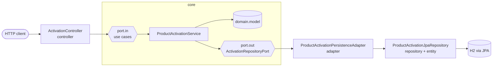

# product-activation-api

REST API to activate products for customers, built with **hexagonal architecture** (ports and adapters).

## Tech stack

| Concern | Technology |
|---|---|
| Language / runtime | Java 21 |
| Framework | Spring Boot 4.1 (Spring MVC) |
| Build | Maven (multi-module, Maven Wrapper included) |
| Persistence | Spring Data JPA + Hibernate 7, H2 (in-memory) |
| Database migrations | Flyway |
| Security | Spring Security OAuth2 Resource Server (JWT) |
| Resilience | Resilience4j (circuit breaker, rate limiter) |
| API documentation | springdoc-openapi (Swagger UI) |
| Observability | Spring Boot Actuator, Micrometer + Prometheus registry |
| Tests | JUnit 5, AssertJ, Spring MockMvc, Spring Security Test |

## Architecture

The project is split into two Maven modules:

```
product-activation-api (parent pom)
├── core   -> business rules. Plain Java, no framework dependencies.
└── app    -> Spring Boot application: controllers, port.out adapters, persistence, configuration and the executable jar.
```

`app` depends on `core`; `core` depends on nothing. Dependencies always point inwards, towards the domain.



### Package layout

```
core/src/main/java/br/com/vdb/core
├── domain
│   ├── model        ProductActivation (aggregate root), ActivationStatus
│   └── exception    Domain exceptions (not found, already exists)
├── port
│   ├── in           Use cases exposed to the outside: ActivateProductUseCase,
│   │                FindActivationUseCase, ActivateProductCommand
│   └── out          What the core needs from the outside: ActivationRepositoryPort
└── service          ProductActivationService (implements the inbound ports)

app/src/main/java/br/com/vdb
├── ProductActivationApplication
├── controller       REST controllers (inbound side) and exception handler (RFC 9457 Problem Details)
│   └── dto          Request/response payloads
├── adapter          Implementations of the core port.out interfaces (e.g. ActivationRepositoryPort)
├── entity           JPA entities
├── repository       Spring Data JPA repositories
└── config           Bean wiring for core services, OpenAPI, security
    └── security     Resource server rules, local JWT encoder/decoder and token endpoint
```

### Rules of thumb

- `core` must never import Spring, JPA or any other framework. Core services are registered as beans in `app` (`config/UseCaseConfig`).
- Controllers depend only on `port.in` interfaces; the core depends only on `port.out` interfaces.
- The `adapter` package only holds implementations of `port.out`. Each adapter uses the `repository` and `entity` packages and maps entities to/from domain objects, so entities never reach the core or the controllers.
- Controllers call use cases through `port.in` and use DTOs from `controller.dto`; they never touch entities or repositories.
- Resilience concerns (rate limiting, circuit breaking) are applied in controllers and adapters, not in the domain.

## Getting started

### Prerequisites

- JDK 21 (`JAVA_HOME` pointing to it)

Maven is optional: use the bundled wrapper (`./mvnw` on Linux/macOS, `mvnw.cmd` on Windows).

### Build and test

```bash
./mvnw clean verify
```

### Run

```bash
./mvnw -pl app -am spring-boot:run
```

or run the packaged jar:

```bash
java -jar app/target/product-activation-api.jar
```

The application starts on `http://localhost:8080` with the `local` profile by default.

## Profiles

| Profile | Purpose | JWT validation |
|---|---|---|
| `local` (default) | Local development and tests | HS256 shared secret (`app.security.jwt.secret`, env `JWT_SECRET`). Tokens are issued by `POST /dev/token`. |
| `prod` | Deployed environments | Validated against an external authorization server: set `JWT_ISSUER_URI`. `/dev/token` does not exist. |

Run with the `prod` profile:

```bash
SPRING_PROFILES_ACTIVE=prod JWT_ISSUER_URI=https://your-idp/realms/your-realm java -jar app/target/product-activation-api.jar
```

> H2 is in-memory, so data is lost on restart. Swap the datasource and add the matching JDBC driver to use a real database; Flyway migrations in `app/src/main/resources/db/migration` will create the schema.
>
> **No Flyway migration exists yet**, so the `product_activation` table is not created at runtime and the `/api/**` endpoints fail with a `500` until the first migration is added (see [Database](#database)).

## Security

The API is an OAuth2 resource server. Every `/api/**` request requires a `Bearer` JWT whose `scope` claim contains:

| Scope | Grants |
|---|---|
| `activations:read` | `GET` endpoints |
| `activations:write` | `POST` endpoints |

Public endpoints: `/actuator/health/**`, `/actuator/info`, `/actuator/prometheus`, Swagger UI and `/v3/api-docs`.

### Getting a token locally

```bash
curl -X POST "http://localhost:8080/dev/token"
```

Optional query parameters: `subject` (default `local-user`) and `scope` (default `activations:read activations:write`).

## API

Base path: `/api/v1/activations`

| Method | Path | Description | Success |
|---|---|---|---|
| `POST` | `/api/v1/activations` | Activate a product for a customer | `201 Created` + `Location` |
| `GET` | `/api/v1/activations/{id}` | Find an activation by id | `200 OK` |

Example:

```bash
TOKEN=$(curl -s -X POST http://localhost:8080/dev/token | sed -E 's/.*"access_token":"([^"]+)".*/\1/')

curl -X POST http://localhost:8080/api/v1/activations \
  -H "Authorization: Bearer $TOKEN" \
  -H "Content-Type: application/json" \
  -d '{"externalId": "EXT-12345", "customerId": "CUST-10001", "productCode": "INTERNET-500"}'
```

Response (`201 Created`):

```json
{
  "id": "0b7f3c1e-5d2a-4c4e-9a51-2f8d7b1e6c90",
  "externalId": "EXT-12345",
  "customerId": "CUST-10001",
  "productCode": "INTERNET-500",
  "status": "PENDING",
  "createdAt": "2026-10-26T14:03:11Z",
  "updatedAt": "2026-10-26T14:03:11Z"
}
```

- `externalId` identifies the request in the caller's system and must be unique: a second request with the same value returns `409`.
- New activations always start as `PENDING`. Possible statuses: `PENDING`, `PROCESSING`, `COMPLETED`, `FAILED`.

Errors are returned as [RFC 9457 Problem Details](https://www.rfc-editor.org/rfc/rfc9457):

| Status | When |
|---|---|
| `400` | Invalid request body or parameters |
| `401` / `403` | Missing/invalid token, or missing scope |
| `404` | Activation not found |
| `409` | An activation with the same `externalId` already exists |
| `429` | Rate limit exceeded |
| `503` | Circuit breaker open |

### Documentation (Swagger)

- Swagger UI: http://localhost:8080/swagger-ui.html
- OpenAPI JSON: http://localhost:8080/v3/api-docs

Use the **Authorize** button in Swagger UI with a token from `/dev/token`.

## Resilience

Configured in `app/src/main/resources/application.yml` under `resilience4j`.

| Instance | Type | Applied to | Default settings |
|---|---|---|---|
| `activationApi` | Rate limiter | `ActivationController` (all endpoints) | 50 requests per second, no waiting (`429` when exceeded) |
| `persistence` | Circuit breaker | `ProductActivationPersistenceAdapter` | Opens at 50% failures over the last 20 calls (min. 10), stays open 30s, 5 trial calls in half-open |

Both instances expose health indicators and Micrometer metrics (`resilience4j_circuitbreaker_*`, `resilience4j_ratelimiter_*`).

## Observability

| Endpoint | Description |
|---|---|
| `/actuator/health` | Aggregated health |
| `/actuator/health/liveness` | Liveness probe (`livenessState`) |
| `/actuator/health/readiness` | Readiness probe (`readinessState` + database) |
| `/actuator/prometheus` | Metrics in Prometheus format |
| `/actuator/metrics` | Metrics browser (authenticated) |
| `/actuator/info` | Application info |

All metrics carry the tag `application=product-activation-api`, and `http.server.requests` publishes histogram buckets for latency percentiles.

### Kubernetes probes

```yaml
livenessProbe:
  httpGet:
    path: /actuator/health/liveness
    port: 8080
readinessProbe:
  httpGet:
    path: /actuator/health/readiness
    port: 8080
```

### Prometheus scrape config

```yaml
scrape_configs:
  - job_name: product-activation-api
    metrics_path: /actuator/prometheus
    static_configs:
      - targets: ["localhost:8080"]
```

## Database

- Flyway migrations: `app/src/main/resources/db/migration` (`V<version>__<description>.sql`). The folder is empty for now.
- The schema is owned by Flyway. Hibernate runs with `ddl-auto: none` until the first migration exists; then switch it to `validate` so Hibernate checks that entities match the schema.
- The integration test sets `ddl-auto=create-drop` so the persistence flow is covered meanwhile. Remove that override once migrations exist.
- The first migration must create the table mapped by `ProductActivationEntity`: `product_activation` (`id`, `external_id` unique, `customer_id`, `product_code`, `status`, `created_at`, `updated_at`).

## Tests

| Module | Test | Scope |
|---|---|---|
| `core` | `ProductActivationServiceTest` | Use case rules with an in-memory fake of the outbound port |
| `app` | `ActivationControllerIntegrationTest` | Full Spring context: HTTP, security scopes, local token flow, persistence, actuator probes, Prometheus and OpenAPI |
