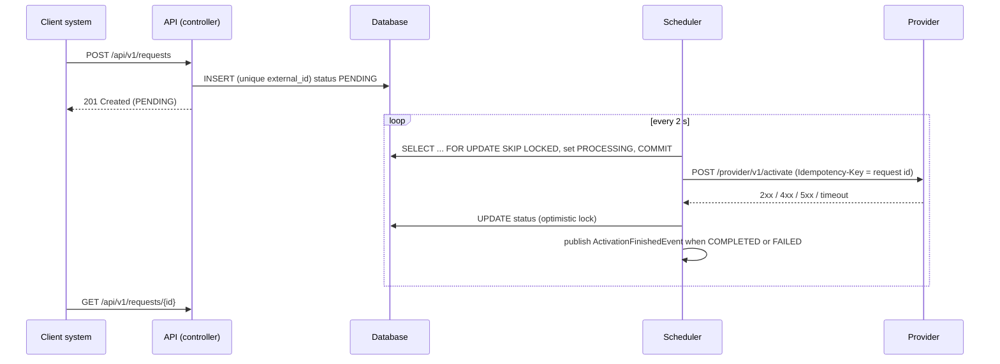

# product-activation-api

Service that receives **product activation requests** from client systems, saves them, lets clients check
their status and sends them to an **external activation provider** in the background.

Built for the *Java Developer Pleno/Sênior* technical challenge. The goal was a solution that is simple and
direct, but safe against duplicates, concurrency and provider failures.

## Contents

- [Tech stack](#tech-stack)
- [How to run](#how-to-run)
- [API](#api)
- [Architecture](#architecture)
- [Technical decisions](#technical-decisions)
- [Tests](#tests)
- [Analysis scenario](#analysis-scenario)
- [Production](#production)
- [Pending items](#pending-items)
- [Future improvements](#future-improvements)
- [Use of AI](#use-of-ai)

## Tech stack

| Concern | Technology |
|---|---|
| Language | Java 21 (records, sealed interfaces, switch with pattern matching, virtual threads) |
| Framework | Spring Boot 4.1 (Spring MVC, Spring Data JPA, Hibernate 7) |
| Build | Maven, multi-module, Maven Wrapper |
| Database | PostgreSQL (Docker Compose / production), H2 (local run and tests) |
| Migrations | Flyway |
| Security | Spring Security OAuth2 Resource Server (JWT) |
| HTTP client | Spring `RestClient` with connect/read timeouts |
| Resilience | Resilience4j (circuit breaker on the provider, rate limiter on the API) |
| Docs | springdoc-openapi (Swagger UI) |
| Observability | Actuator (liveness/readiness), Micrometer + Prometheus, correlation id in logs, JSON logs in `prod` |
| Tests | JUnit 5, Mockito, AssertJ, MockMvc, Spring Security Test, WireMock |
| Delivery | Dockerfile (multi-stage, non-root), Docker Compose, GitHub Actions |

## How to run

### Prerequisites

- JDK 21
- Docker (only for Docker Compose)

### Build and run all tests

```bash
./mvnw verify
```

On Windows use `mvnw.cmd verify`.

### Run locally (H2, no Docker)

```bash
./mvnw -pl app -am spring-boot:run
```

The application starts on `http://localhost:8080` with the `local` profile, which enables:

- an in-memory H2 database (schema created by Flyway);
- `POST /dev/token`, which issues test JWTs (there is no real authorization server locally);
- a **fake provider** at `POST /provider/v1/activate`, called by the application itself.

### Run with Docker Compose (application + PostgreSQL)

```bash
docker compose up --build
```

Same `local` profile features, but data is stored in PostgreSQL.

### Try the full flow

```bash
# 1. Get a token (scopes requests:read and requests:write)
TOKEN=$(curl -s -X POST http://localhost:8080/dev/token | sed -E 's/.*"access_token":"([^"]+)".*/\1/')

# 2. Create a request
curl -i -X POST http://localhost:8080/api/v1/requests \
  -H "Authorization: Bearer $TOKEN" -H "Content-Type: application/json" \
  -d '{"externalId": "EXT-12345", "customerId": "CUST-10001", "productCode": "INTERNET-500"}'

# 3. A few seconds later it is COMPLETED
curl -H "Authorization: Bearer $TOKEN" http://localhost:8080/api/v1/requests/{id}
```

The fake provider answers based on the `productCode`, so every scenario can be tried by hand:

| productCode contains | Fake provider answer | Final result |
|---|---|---|
| (anything else) | `200` | `COMPLETED` |
| `REJECT` | `400` | `FAILED`, no retry |
| `ERROR` | `500` | retries with backoff, then `FAILED` after 5 attempts |
| `BUSY` | `503` + `Retry-After: 10` | retries after at least 10 seconds |
| `SLOW` | answers after 5 s (read timeout is 3 s) | retries, then `FAILED` |

Swagger UI: http://localhost:8080/swagger-ui.html (use **Authorize** with the token).

## API

| Method | Path | Scope | Description |
|---|---|---|---|
| `POST` | `/api/v1/requests` | `requests:write` | Create an activation request |
| `GET` | `/api/v1/requests/{id}` | `requests:read` | Get a request and its current status |
| `GET` | `/api/v1/requests?status=&customerId=&page=&size=` | `requests:read` | List the caller's requests, newest first |

### Create

```json
// request
{ "externalId": "EXT-12345", "customerId": "CUST-10001", "productCode": "INTERNET-500" }

// response: 201 Created, Location: /api/v1/requests/0b7f3c1e-...
{
  "id": "0b7f3c1e-5d2a-4c4e-9a51-2f8d7b1e6c90",
  "externalId": "EXT-12345",
  "customerId": "CUST-10001",
  "productCode": "INTERNET-500",
  "status": "PENDING",
  "createdAt": "2026-10-26T14:03:11Z",
  "updatedAt": "2026-10-26T14:03:11Z"
}
```

Validation rules (all fields required): `externalId`, `customerId` and `productCode` have at most 64 characters
and only letters, numbers, `.`, `_` and `-`. Dates are UTC, ISO-8601.

### List

`status` and `customerId` are optional filters. `page` starts at 0; `size` is 1 to 100 (default 20).

```json
{ "content": [ ... ], "page": 0, "size": 20, "totalElements": 42, "totalPages": 3 }
```

### Errors

Every error uses [RFC 9457 Problem Details](https://www.rfc-editor.org/rfc/rfc9457) with a `traceId`
(the correlation id of the request, also present in the logs). Stack traces are never returned.

```json
{
  "type": "https://product-activation-api/problems/validation-error",
  "title": "Invalid data",
  "status": 400,
  "detail": "One or more fields are invalid.",
  "instance": "/api/v1/requests",
  "traceId": "4bf92f3577b34da6a3ce929d0e0e4736",
  "errors": [ { "field": "customerId", "message": "must not be blank" } ]
}
```

| Status | When |
|---|---|
| `400` | Invalid fields, malformed JSON, invalid id/status/page parameters |
| `401` | Missing or invalid token |
| `403` | Token without the needed scope |
| `404` | Request does not exist, or belongs to another client |
| `409` | `externalId` already used with different data |
| `429` | Rate limit exceeded |
| `500` | Unexpected error (generic message + `traceId`) |

Provider errors never reach the API caller: the provider is called in the background and its result
becomes the request status (`COMPLETED` or `FAILED`, with the reason saved in the database).

Clients can send `X-Correlation-Id`; it is returned in the response, written in every log line and sent to the provider.

## Architecture

Two Maven modules, following ports and adapters (hexagonal), kept small on purpose:

```
product-activation-api
├── core   business rules in plain Java (no Spring, no JPA)
└── app    Spring Boot application
```

```
core/src/main/java/br/com/vdb/core
├── domain
│   ├── model        ActivationRequest (aggregate), ActivationStatus, RetryPolicy
│   ├── event        ActivationFinishedEvent
│   └── exception    domain exceptions
├── port
│   ├── in           use cases: CreateActivationUseCase, FindActivationUseCase, DispatchActivationUseCase
│   └── out          ActivationRepositoryPort, ActivationProviderPort, ActivationEventPublisher
└── service          ActivationRequestService, ActivationDispatchService

app/src/main/java/br/com/vdb
├── controller       REST controller, exception handler, dto/
├── adapter          implementations of port.out: persistence, provider HTTP client, event publisher
├── entity           JPA entity
├── repository       Spring Data repository
├── scheduler        dispatch and reconciliation jobs
├── fakeprovider     fake provider (local profile only)
└── config           bean wiring, properties, security, OpenAPI, metrics, correlation id filter
```

Rules: `core` never imports a framework; controllers only use `port.in`; only adapters use `entity` and
`repository`; JPA entities never leave the adapter.

### Request flow



## Technical decisions

### 1. Duplicates (item 3)

The `external_id` column has a **unique constraint**. That is the real protection.

Checking "does this externalId exist?" and then inserting is not enough: two equal requests can both run the
check before either inserts, and both would insert. Only the database can decide which insert wins.

How it works (`ActivationRequestService.create`):

1. Look up the `externalId` (a fast path for normal client retries).
2. If not found, `INSERT`. If the unique constraint fails, another request won the race:
   read the winner and continue as in step 1.

| Scenario | Response | Why |
|---|---|---|
| Same `externalId`, same data (client retry) | `200 OK` with the existing request | Retries are normal (timeouts, network). The client gets the same answer as the first time, so retrying is safe. `200` (not `201`) shows nothing new was created. |
| Same `externalId`, different data | `409 Conflict`: "externalId ... was already used with different data" | It is not a retry; it is probably a bug in the client. Returning the old request would hide it. |
| Same `externalId` from another client system | `409 Conflict` | `externalId` is unique in the whole service; the other client's data is not returned. |
| Two equal requests in parallel | One gets `201`, the other `200` with the same request | The loser hits the unique constraint, reads the winner and sees the same data. |

`ConcurrentCreationTest` sends 10 parallel requests with the same `externalId` and checks that exactly one row exists.

### 2. Status and transitions

```
PENDING ──► PROCESSING ──► COMPLETED
   ▲             │
   └─────────────┼────────► FAILED
     temporary   │
      failure ───┘
```

- Transitions are methods of the domain (`startProcessing`, `complete`, `fail`, `retryLater`); there are no setters.
  An invalid transition (for example `COMPLETED` → `PROCESSING`) throws `InvalidStatusTransitionException`.
- **Temporary failure → back to `PENDING`** with `attempts + 1`, the error in `last_error` and the time of the next
  try in `next_attempt_at`. I chose this over staying in `PROCESSING` because `PROCESSING` then always means
  "a call is happening now", which makes stuck requests easy to find.
- **Concurrent writes**: the entity has `@Version` (optimistic lock). If two processes change the same request,
  the second save fails and its change is dropped (see reconciliation below).

### 3. Provider integration (item 5)

**Asynchronous.** `POST /api/v1/requests` saves the request as `PENDING` and returns at once. A scheduler calls
the provider later. If the provider is slow (400 ms → 3 s), the API response time does not change, and API
threads are not blocked waiting for it.

**No HTTP call inside a database transaction, and no lost requests.** The table works as an outbox:

1. Short transaction: `SELECT ... WHERE status='PENDING' AND next_attempt_at <= now ... FOR UPDATE SKIP LOCKED`,
   set `PROCESSING`, commit.
2. Call the provider (no transaction open, no connection held).
3. Save the result.

If the application stops after the `INSERT`, the request is still `PENDING` and will be sent. If it stops during
step 2, the request stays `PROCESSING` and the **reconciliation job** (every 1 min) moves requests stuck for more
than 5 min back to `PENDING`.

**Idempotency key.** A timeout is ambiguous: the provider may have activated the product. Every call sends
`Idempotency-Key: <request id>` (the same on every retry), so a provider that supports idempotency keys
activates the product only once. The `X-Correlation-Id` is sent too.

| Provider answer | New status | Retry? | Why |
|---|---|---|---|
| `2xx` | `COMPLETED` | — | Activated. |
| `400` (and other `4xx`) | `FAILED` | No | The request is invalid for the provider; the same request will fail again. |
| `500` (and other `5xx`) | `PENDING` | Yes, with backoff | Usually a temporary provider problem. |
| Timeout / connection error | `PENDING` | Yes, with backoff, same idempotency key | Ambiguous result; the key makes the retry safe. |
| `429` / `503` with `Retry-After` | `PENDING` | Yes, not before `Retry-After` | The provider says when it can take more calls. |
| Circuit breaker open | `PENDING` | Yes, with backoff | The provider is failing a lot; calls are not even sent. |
| Any temporary failure on the last attempt | `FAILED` | No | After 5 attempts the request fails with the last error as reason. |

**Backoff:** `initialBackoff × 2^(attempts-1)`, limited by `maxBackoff`, with **±20% jitter** (a random change so
many failed requests do not all retry at the same second when the provider comes back). With the defaults:
~2 s, 4 s, 8 s, 16 s, then `FAILED`. If the provider sends `Retry-After` (seconds or HTTP date), the delay is the
largest of the two, limited by `maxBackoff`.

**Timeouts:** connect 1 s, read 3 s (configurable).

**Circuit breaker** (Resilience4j, instance `provider`): opens when 50% of the last 20 calls fail
(only `5xx` and timeouts count; `4xx` do not). While open, requests are rescheduled at once instead of waiting
for timeouts.

### 4. Multiple instances

Every instance runs the scheduler. `FOR UPDATE SKIP LOCKED` makes each instance take a different batch without
waiting for the others, and `@Version` protects the final update. Inside one instance the batch (50 requests) is
sent in parallel with one virtual thread per request.

Note on H2: H2 accepts `SKIP LOCKED`, but with `LIMIT` it locks every row that matches the filter, not only the
batch. It is correct, just less parallel. This only matters with several instances, which always use PostgreSQL.

Why not a message queue (RabbitMQ) for the dispatch? It would add infrastructure but not remove the scheduler:
saving to the database and publishing to the queue are two separate writes, so a reliable solution still needs an
outbox table and a job that reads it. Delayed retries in RabbitMQ also need TTL + dead-letter queues or a plugin.
For this volume the database is enough; see [Future improvements](#future-improvements).

### 5. Events

When a request reaches `COMPLETED` or `FAILED` (after all attempts), an `ActivationFinishedEvent` is published
through the `ActivationEventPublisher` port. Today the implementation (`LoggingActivationEventPublisher`) only
writes it to the log. A real broker only needs a new adapter.

With a real broker, publishing right after the database update has the same "two writes" problem: if the
application stops between them, the event is lost. The production version would save the event in an **outbox
table** in the same transaction as the status change, and a job would publish it.

### 6. Security (item 7)

Implemented as an **OAuth2 Resource Server** with JWT:

- **Flow:** *client credentials*. The callers are systems, not people; each system has its own client id and secret
  at the authorization server and gets short-lived tokens.
- **JWT validation:** signature (keys from the issuer's JWKS endpoint, found through `issuer-uri`, cached and
  refreshed by Spring Security when keys rotate), issuer (`iss`), audience (`aud` = `product-activation-api`) and
  expiration (`exp`/`nbf`). Configured in the `prod` profile with `JWT_ISSUER_URI` and `JWT_AUDIENCE`.
- **Scopes:** `requests:write` to create, `requests:read` to read. A system that only checks status gets only `read`.
- **Isolation between clients (BOLA):** each request stores the `client_id` of the token (`client_id`, `azp` or `sub`).
  `GET` returns `404` for requests of another client, and the list always filters by the caller.
- **Rate limit:** 50 calls per second per instance (Resilience4j), `429` when exceeded.
- **Locally** there is no authorization server: the `local` profile validates HS256 tokens signed with a local
  secret and issued by `POST /dev/token`. This endpoint does not exist in `prod`.
- **Provider credential:** the provider here needs none. In production its client secret / API key would be stored in
  the cloud secret manager (AWS Secrets Manager, Azure Key Vault, GCP Secret Manager), injected as an environment
  variable or read at start-up, never in the repository or in logs. Rotation: the secret manager creates the new
  value, both values are accepted by the provider for a while, the pods restart (or reload) and the old value is
  revoked.
- **Body size:** not limited in the application; in production the API gateway / ingress limits it (for example 16 KB).

### 7. Listing and indexes

| Index | Used by |
|---|---|
| `UNIQUE (external_id)` | duplicate protection and lookup by `externalId` |
| `(status, next_attempt_at)` | scheduler (`status='PENDING' AND next_attempt_at <= now ORDER BY next_attempt_at`) and reconciliation (`status='PROCESSING'`) |
| `(client_id, customer_id, created_at)` | list filtered by customer, newest first |
| `(client_id, status, created_at)` | list filtered by status, newest first |

The list always filters by `client_id`, so both list indexes start with it. A list with only `client_id`
uses either index by its first column.

### 8. Configuration

Everything in `application.yml` can be changed with environment variables:

| Variable | Default | Meaning |
|---|---|---|
| `ACTIVATION_BATCH_SIZE` | `50` | requests claimed per scheduler run |
| `ACTIVATION_DISPATCH_DELAY` | `2s` | pause between dispatch runs |
| `ACTIVATION_RECONCILIATION_DELAY` | `1m` | pause between reconciliation runs |
| `ACTIVATION_STUCK_AFTER` | `5m` | time in `PROCESSING` before a request is considered stuck |
| `ACTIVATION_MAX_ATTEMPTS` | `5` | provider calls before `FAILED` |
| `ACTIVATION_INITIAL_BACKOFF` / `ACTIVATION_MAX_BACKOFF` | `2s` / `5m` | backoff limits |
| `ACTIVATION_RETRY_JITTER` | `0.2` | ±20% |
| `PROVIDER_BASE_URL` | local fake provider | provider address |
| `PROVIDER_CONNECT_TIMEOUT` / `PROVIDER_READ_TIMEOUT` | `1s` / `3s` | HTTP client timeouts |
| `JWT_ISSUER_URI` / `JWT_AUDIENCE` | — / `product-activation-api` | token validation (`prod`) |

## Tests

```bash
./mvnw verify
```

| Test | Type | What it covers |
|---|---|---|
| `ActivationRequestTest` | Unit (no Spring) | Valid and invalid status transitions |
| `RetryPolicyTest` | Unit | Exponential backoff, limit, jitter range, `Retry-After` |
| `ActivationRequestServiceTest` | Unit (Mockito) | Create, client retry (`200`), different data (`409`), lost race, other client's request |
| `ActivationDispatchServiceTest` | Unit (Mockito) | Each provider result → status, max attempts, events, concurrent update, reconciliation |
| `ActivationRequestApiTest` | Integration (Spring + MockMvc + H2) | HTTP contract, validation and Problem Details, `201`/`200`/`409`/`404`, list filters and paging, client isolation, `401`/`403`, probes, metrics, OpenAPI |
| `ConcurrentCreationTest` | Integration (H2 + Flyway schema) | 10 parallel creates with the same `externalId` → one row |
| `ActivationDispatchIntegrationTest` | Integration (WireMock as provider) | Success, `400`, `500`, timeout, `503` + `Retry-After`; idempotency and correlation headers; event published |

Strategy: business rules are tested without Spring, so the tests are fast and show the rules clearly. Integration
tests check what unit tests cannot: HTTP mapping, security, SQL (the unique constraint, `SKIP LOCKED`, optimistic
lock) and the real HTTP client with timeouts. Tests use H2 with the same Flyway migration; the Docker Compose
setup runs the same code on PostgreSQL. Testcontainers was left out to keep the build simple (see pending items).

## Analysis scenario

> API average time 300 ms → 2.5 s, some queries 50 ms → 1.2 s, provider 400 ms → 3 s, CPU 45%, memory 60%.

**What I would check first.** CPU and memory are normal, so the application is **waiting**, not working:
waiting for database connections, for slow queries or for the provider. I would start with the database,
because the API endpoints talk to it directly, while the provider is called in the background in this design.

**Application, database or provider?**

- Compare the API latency (`http_server_requests`) with database time and provider time (`http_client_requests`)
  for the same period. If API time ≈ query time + time waiting for a connection, the problem is in the database.
- Check the connection pool: `hikaricp_connections_pending` and `hikaricp_connections_acquire` high means
  requests are queuing for a connection.
- In PostgreSQL: `pg_stat_statements` (slowest queries), `pg_stat_activity` (waiting and locked sessions), and
  `EXPLAIN ANALYZE` of the slow queries (missing index, sequential scan on a table that grew).
- For the provider: `http_client_requests` by status and the circuit breaker metrics; is it slow for all calls
  or only some?

**Useful logs and metrics.** Latency percentiles (p95/p99, not only the average), Hikari pool metrics,
slow query log, `activation_requests{status}` (a growing `PENDING`/`PROCESSING` backlog), provider latency and
error rate, circuit breaker state, and logs with `correlationId` to follow one slow request end to end.

**Can the three symptoms have one cause?** Yes. Hypothesis: the table grew a lot and a query became slow
(for example a list query without a good index, or the scheduler query). Slow queries hold connections longer,
the pool runs out, and every API call waits for a connection: API time goes up while CPU stays low. If the
provider slowness comes from the same infrastructure (same network, same database, or our retries putting more
load on it), it also gets worse. Another common single cause: the provider got slow and something holds a
database connection during the HTTP call (a transaction around the call, or open-in-view) — this design avoids
it on purpose. To confirm: correlate in time the start of the slow queries, the pool wait time and the API
latency; check `EXPLAIN` before/after; check whether the provider latency is the same when measured outside
our service.

**Possible improvements.** Add or fix indexes (based on `EXPLAIN`), keep transactions short, tune the pool size,
use pagination limits (already in place), archive old final requests, make sure no HTTP call holds a connection,
tune provider timeouts and circuit breaker, and, if needed, cache read-heavy data.

**How to check the fix worked.** Compare p95/p99 latency, pool wait time and query time before and after the
deploy on dashboards, with an alert on the target values; follow a canary or a part of the traffic first;
check the slow query is gone from `pg_stat_statements`.

## Production

**How I would run it:**

- Build the image in CI (`docker build`), push it to a registry with the commit SHA as tag.
- Run at least 2 replicas in a container platform (Kubernetes, ECS, Cloud Run...) with the `prod` profile and
  managed PostgreSQL.
- Probes: liveness `/actuator/health/liveness`, readiness `/actuator/health/readiness` (includes the database).
- Configuration by environment variables (table above); secrets (database password, provider credentials) from
  the cloud secret manager, never in the image.
- The image runs as non-root, uses `MaxRAMPercentage=75` (JVM memory follows the container limit), and has
  graceful shutdown (in-flight requests and scheduled jobs get time to finish on `SIGTERM`).
- Logs in JSON (ECS format) with the correlation id, sent to the log platform; `/actuator/prometheus` scraped by Prometheus.

**Several instances:** safe by design (unique constraint for duplicates, `SKIP LOCKED` + `@Version` for processing).

**Other microservices** learn about finished activations through `ActivationFinishedEvent` published to a topic
(with an outbox table, see decision 5).

**CI/CD:** GitHub Actions runs `./mvnw verify` and `docker build` on every push and pull request
(`.github/workflows/ci.yml`). The next steps would be: push the image, deploy to a staging environment, run
smoke tests, then deploy to production (rolling or canary).

## Pending items

| Item | How I would do it |
|---|---|
| Testcontainers | Run `ConcurrentCreationTest` and the dispatch test against a PostgreSQL container, to test `SKIP LOCKED` with real row locks. Left out to keep the build simple and Docker-free. |
| Real message broker | New `ActivationEventPublisher` adapter for RabbitMQ/Kafka plus an outbox table written in the same transaction as the status change. |
| Request body size limit | At the API gateway / ingress. |
| Distributed tracing | Micrometer Tracing + OpenTelemetry exporter; the trace id would replace the custom correlation id. |
| Architecture tests | ArchUnit rules: `core` has no Spring imports; controllers do not use `entity`/`repository`. |
| ADRs | `/docs/adr` with the main decisions above. |

## Future improvements

- Outbox table for events and publishing to a broker (RabbitMQ/Kafka).
- For very high volume, move the dispatch to a queue: the outbox job publishes, consumers in many pods call the
  provider, final failures go to a dead-letter queue.
- Rate limit per client (today it is per instance, for all clients).
- Endpoint or job to re-send `FAILED` requests after a manual fix.
- Archive or delete old final requests.
- Alerts: `PENDING` backlog growing, circuit breaker open, `FAILED` rate.

## Use of AI

I used Claude Code (Anthropic) as a pair programmer during this challenge: to discuss the design options
(sync vs async dispatch, queue vs database polling, duplicate strategy), to generate the first version of the code,
tests and this README, and to check behaviours (for example, how H2 handles `SKIP LOCKED`). I reviewed the decisions,
the code and the tests, and the final choices are mine.
